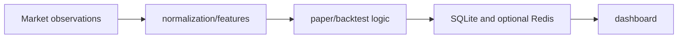

# Market Microstructure Lab

**Order-book normalization, closed-timeframe research and paper-market state.**

  [](LICENSE)

[Overview](#overview) · [Quickstart](#quickstart) · [Example](#example) · [Validation](#validation) · [Documentation](#documentation)

## Overview

A Python research workspace for order-book normalization, backtesting and paper-market monitoring.

**Stack:** Python · SQLite · Redis RESP client · WebSocket · JavaScript/HTML dashboard

## Keep market structure and simulated outcomes distinct

| Component | Behavior |
| --- | --- |
| Normalize | Order-book helpers reject invalid, empty and crossed inputs. |
| Research | Backtest helpers align closed timeframes and exit conditions. |
| Inspect | SQLite paper state and optional Redis updates feed a local dashboard. |

## Processing path



## Quickstart

```console
python -m unittest discover -s tests -v
```

The commands above install prerequisites or run the specified offline checks. Live collection, cloud operations, messaging and trading are separate operational steps when present.

## Example

**Inspect the workflow**

Use the offline tests to inspect valid and rejected order books. Follow normalized observations into feature/backtest calculations and persisted paper state. Dashboard and live-feed commands require separate data/services; a paper position is simulated state, not an executed order.

## Configuration and storage

Python modules use the standard library. SQLite persists research/paper state and a Redis RESP client can publish updates. External feeds and historical datasets are separate inputs.

## Repository guide

| Location | Responsibility |
| --- | --- |
| [bulk_market_data.py](bulk_market_data.py) | Market observations |
| [bulk_micro_scalper_backtest.py](bulk_micro_scalper_backtest.py) | Backtest calculations |
| [paper_live_monitor.py](paper_live_monitor.py) | Paper monitoring |
| [tests](tests) | Offline regression checks |

## Validation

These checks use offline fixtures or controlled backends.

## Scope and operational boundaries

Historical simulations and paper monitoring do not establish live profitability or fill quality. Downloaded third-party Rust SDKs are excluded and are not represented as original implementation.

## Documentation

- The repository guide above links directly to the implementation and configuration files.

## License and attribution

Project-authored source code is licensed under the [MIT License](LICENSE). Third-party components and datasets retain their respective rights and licenses.
